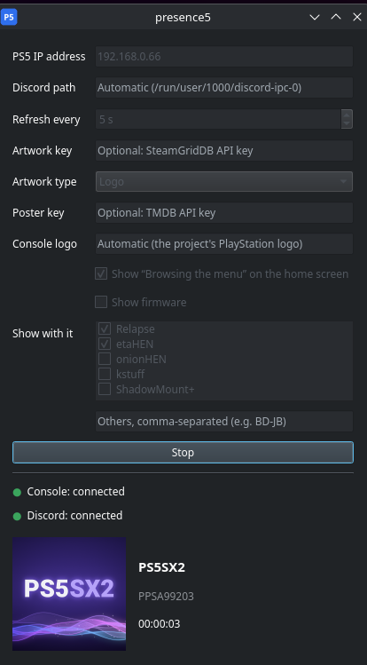
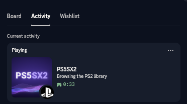

# Presence5

**Version 1.1.0** · [Release notes](RELEASE_NOTES.md)

A PlayStation5 payload that works alongside a desktop client to display your game activity on Discord
through its Rich Presence feature.

| Client preview | Discord preview |
| :---: | :---: |
|  |  |

The payload runs on the console and reports which game is open and for how long. The client runs
on your PC, asks the payload every few seconds, and passes the result to your local Discord app.

## Setup

Please note that this has been tested on firmware 13.42, CachyOS and Windows 11. I will
be more than happy to fix any issues that come up, so feel free to open one.

### What you will need

- The latest payload (`presence.elf`) and client from the
  [releases page](https://github.com/AmineWallah/presence5/releases). Either the GUI or the CLI
  client will do the job.
- A jailbroken PS5 with an ELF loader.
- The Discord desktop app, open on the same PC as the client. The browser version will not work.
- Your PS5 and your PC on the same local network.
- **Optional but recommended:** [PS5 Payload Manager](https://github.com/itsPLK/ps5-payload-manager)

### 1. Load the payload on the PS5
**It is VERY RECOMMENDED to load it with PS5 Payload Manager, but if you do not have access to it:**

Send `presence.elf` to your ELF loader, which usually listens on port 9021. Replace `<PS5_IP>`
with your console's IP address, found on the PS5 under
Settings > Network > Connection Status > View Connection Status.

```sh
nc -q0 <PS5_IP> 9021 < presence.elf
```

If your version of `nc` does not accept `-q0`, use `-N` or `-w 1` in its place.


A "Server initialized" notification on the console means the payload is running. It keeps
running until the console is turned off or restarted, so it needs to be loaded again after each
jailbreak.

To stop the payload without restarting the console:

```sh
echo QUIT | nc -w 1 <PS5_IP> 8000
```

### 2. Run the client on your PC

Make sure Discord is open, and that activity sharing is turned on in Discord under
Settings > Activity Privacy.

#### GUI

| System | How to start it |
| --- | --- |
| Linux | `chmod +x presence5-linux`, then `./presence5-linux` |
| Windows | Double-click `presence5-windows.exe` |

Enter your PS5's IP address and press **Start**. The game you are playing shows up in the window
and on your Discord profile within a few seconds.

The other settings are optional:

| Setting | What it does |
| --- | --- |
| Artwork key | A [SteamGridDB](https://www.steamgriddb.com) API key, for game logos and icons. See [Game artwork](#game-artwork). |
| Artwork type | Which SteamGridDB picture to show: **Logo**, **Icon** or **Cover**. |
| Poster key | Optional [TMDB](https://www.themoviedb.org) API key, for the best Blu-ray posters. See [Movies and TV](#movies-and-tv). |
| Show firmware | The console's firmware on the cards. See [Firmware and setup](#firmware-and-setup). |
| Show with it | Tick the exploit, HEN and tools you use (Relapse, etaHEN, onionHEN, kstuff, ShadowMount+), or type others; they're shown next to the firmware. |
| Console logo | Public web address of the PlayStation logo to show. Leave empty for the project's own (see [The PlayStation logo](#the-playstation-logo)). |
| Show "Browsing the menu" | When ticked, Discord shows *Playing PlayStation 5 / Browsing the menu* while you are on the home screen. Untick it to show nothing there. |
| Open presence5 when I log in | Opens the app hidden in the tray every time you log in to your PC. See [Starting by itself](#starting-by-itself). |
| Start sharing as soon as presence5 opens | Presses **Start** for you, with the settings above. |

Closing the window sends the client to the system tray, where it keeps running. Click the tray
icon to bring the window back, or right-click it and choose **Quit** to exit.

#### Starting by itself

Tick both **Startup** options and presence5 runs without you opening it: when you log in to your
PC it opens hidden in the tray and starts sharing. If the PS5 or Discord isn't on yet, it keeps
waiting for them.

- **Linux:** adds `presence5.desktop` to `~/.config/autostart`, which KDE, GNOME, Xfce, Cinnamon
  and other desktops open at login. It shows up in your desktop's autostart settings.
- **Windows:** adds presence5 to your startup apps (Task Manager › Startup apps, or Settings ›
  Apps › Startup), for your account only. No administrator rights needed.

Put the program somewhere it will stay (not a folder you clean out, like Downloads) before you
tick the option: the entry points to the file where it is. If you move it or download a new
version, open it once and the entry is updated. Untick the option to remove the entry.


#### CLI

```sh
# Linux
chmod +x presence5-linux-cli
./presence5-linux-cli <PS5_IP>

# Windows
presence5-cli.exe <PS5_IP>
```

| Option | Description |
| --- | --- |
| `-i`, `--interval SECONDS` | How often to ask the console for its state. Default: 5. |
| `-d`, `--discord PATH` | Path to Discord's IPC socket or pipe, if it is not found automatically. |
| `--no-menu` | Show nothing on Discord while the console is on the home screen. |
| `--sgdb-key KEY` | SteamGridDB API key for game artwork. Can also be set with the `SGDB_API_KEY` environment variable. |
| `--art {logo,icon,cover}` | Which SteamGridDB picture to show. Default: `logo`. |
| `--tmdb-key KEY` | TMDB API key or read access token, for Blu-ray posters. Can also be set with `TMDB_API_KEY`. |
| `--no-firmware` | Don't show the firmware. |
| `--show LIST` | What to show with the firmware, comma-separated, e.g. `--show "Relapse,kstuff"`. |
| `--logo-url URL` | Public web address of the PlayStation logo to show. |
| `-v`, `--verbose` | Print debug output. Useful when reporting an issue. |

Press Ctrl+C to stop it.

The client does not have to be started after the payload. If the console or Discord is not
available, it keeps retrying until they are.

## Build from source

### Payload

You need the [PS5 Payload SDK](https://github.com/ps5-payload-dev/sdk) installed, with the
`PS5_PAYLOAD_SDK` environment variable pointing at it.

```sh
export PS5_PAYLOAD_SDK=/opt/ps5-payload-sdk
make -C payload
```

This produces `payload/presence.elf`.

### Client

You need Python 3.10 or newer and [uv](https://docs.astral.sh/uv/).

```sh
uv sync

# Run from source
uv run client/gui.py
uv run client/main.py <PS5_IP>

# Build standalone executables into dist/
uv run pyinstaller --onefile --windowed --name presence5 client/gui.py
uv run pyinstaller --onefile --name presence5-cli client/main.py
```

Executables are built for the system you run the build on, so the Windows ones have to be built
on Windows and the Linux ones on Linux.

On Windows, double-click `build-windows.bat`. It installs uv if needed (uv fetches Python by itself),
then builds `presence5-windows.exe` and `presence5-cli.exe` into `dist\`.

### Automatic builds

`.github/workflows/release.yml` builds the payload and the Linux and Windows clients on GitHub.
Pushing a tag such as `v1.0.0` also publishes them as a release, described by `RELEASE_NOTES.md`.
It can be run by hand from the Actions tab to just get the files.

## How it looks on Discord

| Console state | Discord card | Member list |
| --- | --- | --- |
| In a game | The game's name, *Playing on PlayStation 5* under it, the game's artwork with a small PlayStation logo, and the time played | Playing *game name* |
| In a PS2 game in PS5SX2 | The PS2 game's name, *Playing on PlayStation 5*, *PS2 · PS5SX2*, the PS2 cover with a small PS5SX2 icon | Playing *game name* |
| In a game in ProsperoEden | The game's name, *Playing on PlayStation 5*, *Switch · ProsperoEden*, the game's cover with a small ProsperoEden icon | Playing *game name* |
| In ProsperoEden's library | **ProsperoEden**, *Browsing the Switch library*, the ProsperoEden icon | Playing ProsperoEden |
| In PS5SX2's menu | **PS5SX2**, *Browsing the PS2 library*, the PS5SX2 icon | Playing PS5SX2 |
| Watching a Blu-ray | **Watching** the movie or show, its poster, the season and disc for series, *Blu-ray* or *4K Ultra HD*, and the time since the disc started | Watching *title* |
| In a streaming app (Netflix, YouTube, Crunchyroll…) | **Watching** the app's name and its icon | Watching *app name* |
| In a system app (Settings, PlayStation Store…) | **PlayStation 5** and what you're doing, e.g. *In Settings* | Playing PlayStation 5 |
| On the home screen | **PlayStation 5**, *Browsing the menu*, the PlayStation logo, and the time since you left your last game | Playing PlayStation 5 |
| Off, or the payload is not running | Nothing | Nothing |

The menu timer starts when the client first sees the home screen, so if you start the client while
already on the home screen, it counts from then.

## Game artwork

The client looks for a picture of the game in this order:

1. **Homebrew catalog**, by title ID. Homebrew listed in the
   [PS5 homebrew catalog](https://github.com/darkxex/ps5-homebrew-catalog) gets its own icon.
2. **Discord's own game list**, by name. Discord keeps a public list of the games it recognises, each with
   an icon, and this is the picture it shows for the game on PC. Edition words such as "Special
   Edition" or "Director's Cut" are ignored if the full name finds nothing, so a PlayStation edition
   still finds the PC game. If Discord's copy of the list can't be read, the client uses
   [dgdb](https://github.com/teyd/dgdb), a daily mirror of it.
3. **SteamGridDB**, if you've set a key (see below).
4. **The PlayStation Store cover**, as described under [How the titles are resolved](#how-the-titles-are-resolved).

If none of them has a picture, the PlayStation logo is shown instead.

For games Discord doesn't know, such as homebrew or PlayStation exclusives it has never listed, get
a free API key from
[SteamGridDB](https://www.steamgriddb.com/profile/preferences/api) (you need a Steam account to sign
in) and enter it as the artwork key. The client then looks the game up by name and uses the
best-voted picture of the type you picked, whenever Discord's list has nothing. If SteamGridDB has
nothing for a game either, or the key is wrong, it falls back to the store cover, and the GUI says
so.

Discord shows the large image in a square, so **Icon** and **Cover** fill it best. Logos are usually
wide; if Discord crops yours badly, switch to Icon.

## Games in ProsperoEden

[ProsperoEden](https://github.com/cualquiercosa327/ProsperoEden) also runs every game under its
own title ID (`PPSA99008`), and it has no network API. The payload reads two of the files
ProsperoEden writes itself (its `EDEN` command):

- `logs/stderr.log`, its session log. A "Game loaded" line means a game is running, a
  "shutdown" line means it is back in the library. Only what was added since the last check is
  read.
- `config/prosperoeden.json`, where it saves the file name of the game it last started.

The game's name is the file name without its tags: `Sample Quest [0100ABCD12345000][v0].nsp`
shows as *Sample Quest*. The cover, and the official name Discord shows, come from the first of
these that knows the game:

1. [Rich Presence U's title database](https://github.com/ninstar/rich-presence-u-db): about 900
   Switch games with a 512×512 icon each, matched by name (accents and punctuation ignored).
2. Nintendo of Europe's game search.
3. The program ID in the file name, Discord's game list, SteamGridDB (with a key), and the game's
   Wikipedia article.

Without any, the ProsperoEden icon is shown. The timer starts when the game was started.

This needs the payload from this version, and ProsperoEden's data in its usual place
(`/data/prosperoeden`). Name your files after the game for the right title on Discord.

## Firmware and setup

The payload's `FW` command reports the console's firmware, read from the kernel. Next to it you can
show the exploit, HEN and tools you use: tick them in **Show with it** (Relapse, etaHEN, onionHEN,
kstuff, ShadowMount+) or type others. Nothing is detected; what you pick is what's shown.

They show up in three places:

- On the home-screen card (and the cards for Settings and other system apps), the last line:
  *Firmware 13.42 · Relapse · kstuff*.
- Up to two buttons on that card, for the first picked items that have a page: *Relapse · FW
  13.42* and *kstuff*. Discord doesn't show your own buttons to you; other people see them.
- When hovering over the small logo on every card: *PlayStation 5 · FW 13.42 · Relapse · kstuff*,
  or *PS5SX2 · …* and *ProsperoEden · …* on emulator cards.

Anyone who can see your Discord profile sees all this. Untick **Show firmware** (or use
`--no-firmware`) and pick nothing to show none of it.

## When the connection drops

If the PS5 loses its network (Wi-Fi drop, cable pulled, rest mode), the payload closes its
listening socket and tries to open it again after 5, 10, 20 and then every 30 seconds. It shows
one notification when the connection is lost and one when it is listening again, and never
retries without waiting, so it doesn't slow the console down. It does not need to be re-sent.

The PC client keeps the card through a single missed answer. After two it clears the card and
checks less often (10, 20, then every 30 seconds) until the console answers again.

## PS2 games in PS5SX2

[PS5SX2](https://github.com/Swordpdf/PS5SX2) runs every PS2 game under its own title ID (or one of
its home-screen tiles), so the console alone can only say "PS5SX2 is running". While PS5SX2 is open,
the client also asks PS5SX2's settings page (`http://<PS5_IP>:8844/api/state`) which PS2 game is
playing. That gives the game's name and serial, and the serial finds the game's cover in the
[xlenore PS2 cover set](https://github.com/xlenore/ps2-covers), the same one PCSX2 uses. Starting a
different game inside PS5SX2 updates Discord and restarts the timer.

PS2 games are never matched by name against Discord's list, so *God of War* (2005) can't turn into
the 2018 game.

The settings page is on unless you've turned it off with PS5SX2's `nowebui` flag. Without it, the
client shows the name of the tile you started (or PS5SX2) with PS5SX2's icon.

## Movies and TV

When the PS5's disc player (`NPXS40140`) is open, the client asks the payload about the disc:

- **Name.** Most commercial Blu-rays carry their title in `BDMV/META/DL/bdmt_*.xml`; others only
  have a volume label such as `BREAKING_BAD_S1_D3`. The client cleans either up: it removes format
  words (*Ultra HD*, *Blu-ray*, *4K*), studio names in front (*Marvel Studios'*), and trademark
  signs, and splits off the season, disc and volume numbers (*S3 D1*, *Season 1 Disc 2*, *The
  Complete First Season*, *Vol. 2*).
- **Poster and official title.** The cleaned name is looked up, and the first confident match is
  used for both the poster and the title Discord shows, so *MARVEL STUDIOS' DEADPOOL AND WOLVERINE
  \- Ultra HD™* shows as *Deadpool & Wolverine*. Edition words (*10th Anniversary Edition*,
  *Director's Cut*) are left out of the search. A disc whose title is a placeholder (such as `.`)
  is looked up by its volume label instead.
  - The name is first pinned to one film or show: Cinemeta (Stremio's IMDb-based catalogue)
    gives its official title and IMDb id. Sources that can look a show up by that id (TMDB,
    TVmaze) do, so they can't land on a different show with a similar name. Discs often shorten
    the name (*ReZero*): a database title that starts with the disc's name counts as a match.
  - For a series with a season number, that season's poster comes first, from TMDB (with a key),
    [AniList](https://anilist.co) (anime, where every season has its own cover; sequels with
    names of their own are found by following the sequel links), [TVmaze](https://www.tvmaze.com),
    iTunes, or the season's Wikipedia article, whichever has it. A poster for a different season
    is never used.
  - Otherwise, or if no season poster is found, the film's or show's own poster: TMDB (with a
    poster key, free at [themoviedb.org/settings/api](https://www.themoviedb.org/settings/api)),
    then Cinemeta, iTunes, and Wikipedia.
  - The season and disc numbers are read from both the title and the volume label
    (*Dexter: Season 5* + `DEXTER_S5_D2`), in any of the usual spellings (`S1D3`, *Season 1 Disc
    3*, *The Complete First Season*).

  To see how a name is read and what each source answers, run
  `presence5-cli --poster-test "Dexter S5 D1"`.
- **Series.** The season and disc go on the card's last line, e.g. *Season 3 · Disc 1 ·
  Blu-ray*. Which episode is playing isn't something the console reports, so episode names
  aren't shown.
- **4K.** Ultra HD discs are labelled *4K Ultra HD* instead of *Blu-ray*.

If the disc isn't mounted anywhere the payload can see, it reads the files straight off the drive
(`/dev/cd0`), and failing that uses the disc's volume name ("THE_BACKROOMS" becomes "The
Backrooms").

This needs the payload from this version. Sending it replaces a presence payload that is already
running. With an older payload, a disc shows as *Blu-ray Disc Player*.

If a disc still shows as *Blu-ray Disc Player*, run the CLI with `-v`: it logs the payload's
answer, including where it looked for the disc (`MOUNT`, `ROOT` and `DEVICE` lines).

Streaming apps (Netflix, YouTube, Disney+, Prime Video, Crunchyroll, Max, Plex and others) show as
*Watching* the app, and music apps such as Spotify as *Listening to* it. Which show or song is
playing isn't available to the payload, so there's no title for those.

## The PlayStation logo

Discord can only show pictures it can download from the internet, not files on your PC. The logo is
in this repository as [`assets/ps-logo.png`](assets/ps-logo.png), and the client uses the first of
these that is online:

1. The address in the **Console logo** setting (or `--logo-url`), if you set one.
2. `assets/ps-logo.png` in this repository on GitHub.
3. A white-on-black PlayStation mark from [Simple Icons](https://simpleicons.org), drawn by
   [images.weserv.nl](https://images.weserv.nl).
4. The coloured PlayStation logo from [dashboard-icons](https://github.com/homarr-labs/dashboard-icons).

To use your own picture, upload it anywhere that gives a direct image link (a GitHub repository's
"raw" link works) and put that link in the setting.

## How the titles are resolved

The payload only knows a game's title ID, such as `PPSA17221` or `CUSA00900`. The client turns
that into a name and a cover image by trying these sources in order:

1. **The game's own `param.json`, read from the console.** This covers PS5 games and homebrew.
   The name comes from the file, and the cover is fetched from the PlayStation Store using the
   content ID found in it.
2. **Sony's title metadata service, looked up by title ID.** This covers PS4 games, which have no
   `param.json`.
3. **The title ID on its own,** if neither of the above returns anything.

The name found in step 1 or 2 is then used to find the game's artwork, as described under
[Game artwork](#game-artwork); the store cover is the last resort.

Results are remembered while the client is running, so each game is only looked up once.

The two Sony services used here are not officially documented. If they change, names or covers
may stop appearing until the client is updated. Game detection and the timer do not depend on
them.

## Logo and Payload Manager

The logo is `assets/presence5.svg` (also `presence5-512.png`, and `presence5.ico` for Windows). It
is the app's window and tray icon and the Windows programs' icon.

[PS5 Payload Manager](https://github.com/itsPLK/ps5-payload-manager) takes payload icons from the
repository a payload comes from, not from the payload file. `payload-manager/` is a ready
repository with Presence5 and its logo; see [its README](payload-manager/README.md).

## Credits

- [PS5 Payload SDK](https://github.com/ps5-payload-dev/sdk) by John Törnblom, used to build the
  payload.
- [etaHEN](https://github.com/etaHEN/etaHEN) by LightningMods, whose Discord RPC server this
  payload's game detection is based on.
- [PS5 Payload Manager](https://github.com/itsPLK/ps5-payload-manager) by itsPLK.
- [SteamGridDB](https://www.steamgriddb.com) for game artwork.
- [dgdb](https://github.com/teyd/dgdb) by teyd, a daily mirror of Discord's game list.
- [PS5SX2](https://github.com/Swordpdf/PS5SX2) by Sword, whose settings page says which PS2 game
  is playing.
- [ProsperoEden](https://github.com/cualquiercosa327/ProsperoEden) by BlackBearReloaded, whose
  log and settings say which game is running.
- [Rich Presence U database](https://github.com/ninstar/rich-presence-u-db) by NinStar (ODbL),
  for Switch game icons.
- [ps2-covers](https://github.com/xlenore/ps2-covers) by xlenore, for PS2 covers.
- [ps5-homebrew-catalog](https://github.com/darkxex/ps5-homebrew-catalog) by darkxex, for homebrew
  icons.
- Posters from [TMDB](https://www.themoviedb.org) (this product uses the TMDB API but is not
  endorsed or certified by TMDB), [Cinemeta](https://v3-cinemeta.strem.io), Apple's
  [iTunes Search API](https://performance-partners.apple.com/search-api),
  [AniList](https://anilist.co), [TVmaze](https://www.tvmaze.com) and Wikipedia.
- Fallback PlayStation logo from [dashboard-icons](https://github.com/homarr-labs/dashboard-icons)
  (Apache 2.0).
  - Built with help from [Claude](https://claude.ai) by Anthropic.

## License

Presence5 is released under the GNU General Public License, version 3 or later. See
[LICENSE](./LICENSE) for the full text.
